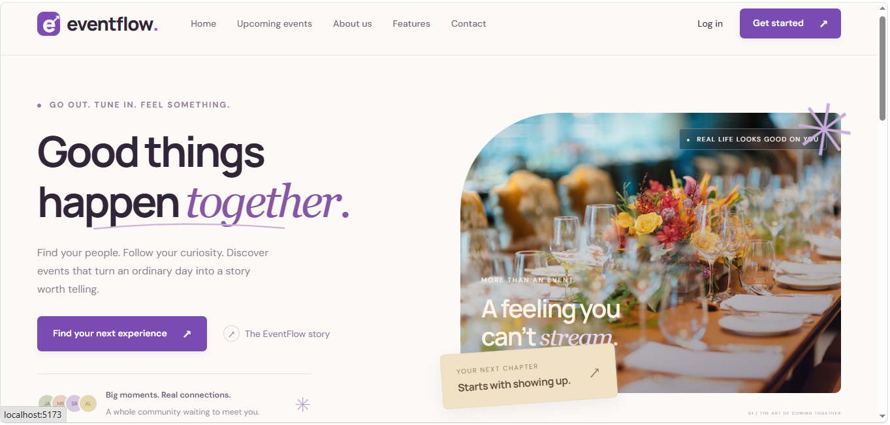
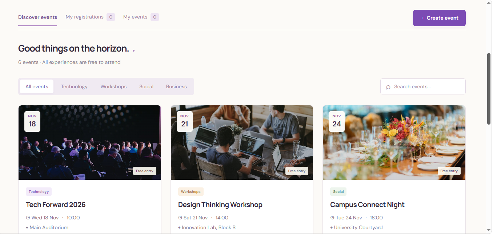
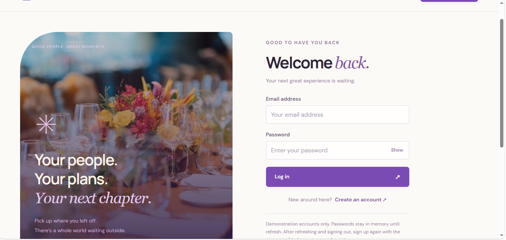
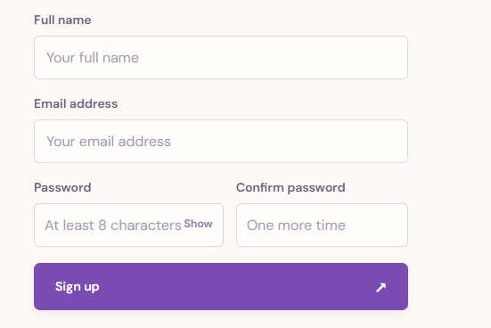
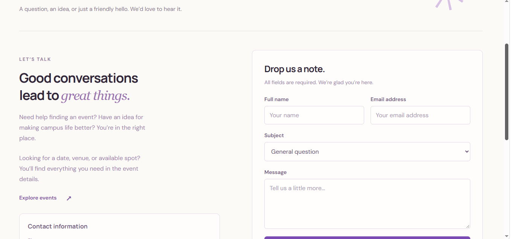
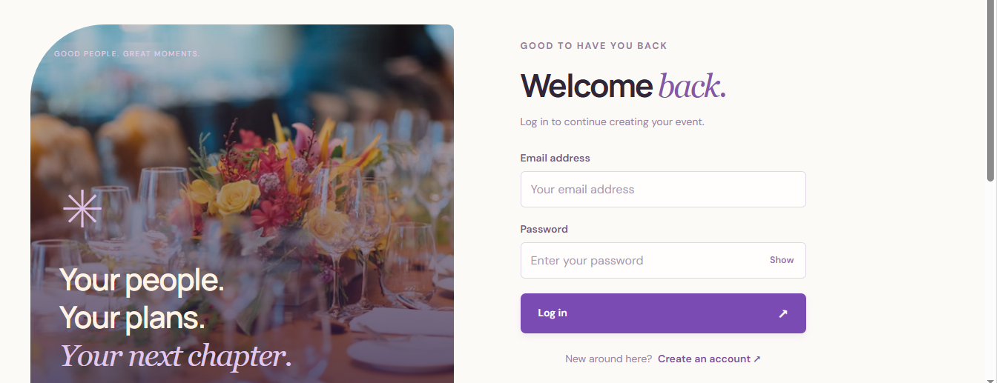

# EventFlow – Event Management System

## 1. Project Description

EventFlow is a web application developed using ReactJS for managing and discovering events.

The website allows users to browse upcoming events, search for events by category, and view event details. Users can also create, edit, and delete their own events and register for available events.

The project includes seven main pages:

- Home
- Events
- Features
- About
- Login
- Sign Up
- Contact

EventFlow uses React components, React Router, JavaScript, and CSS to provide an interactive and responsive user interface.

Event information is managed using React state and browser localStorage. The application is a frontend project without a backend database.

## 2. Setup Instructions

To run EventFlow on your computer, follow these steps.

**Step 1:** Install Node.js and npm.

**Step 2:** Download or clone the project from GitHub.

**Step 3:** Open the project folder in Visual Studio Code.

**Step 4:** Open the terminal and install the required dependencies.

```bash
npm install
```

**Step 5:** Start the development server.

```bash
npm run dev
```

**Step 6:** Open the local address displayed in the terminal,

## 3. Screenshots of the UI

### Home Page

![Home Page]

### Events Page

![Events Page]

### Features Page

![Features Page]

### About Page

![About Page]

### Login Page

![Login Page]

### Sign Up Page

![Sign Up Page]

### Contact Page

![Contact Page]

### Create Event

![Create Event]